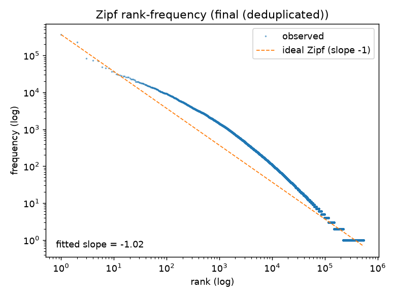
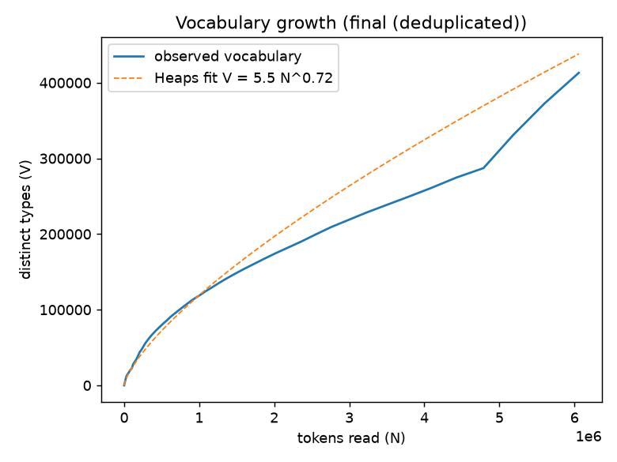
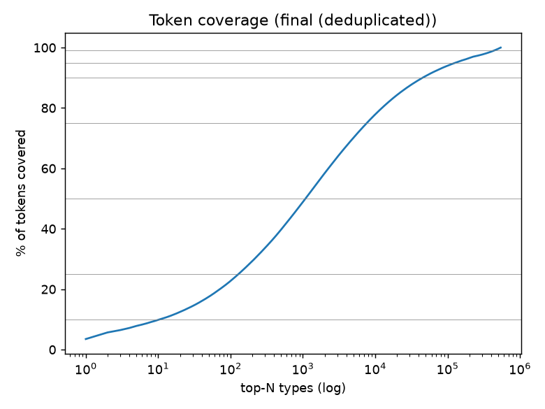
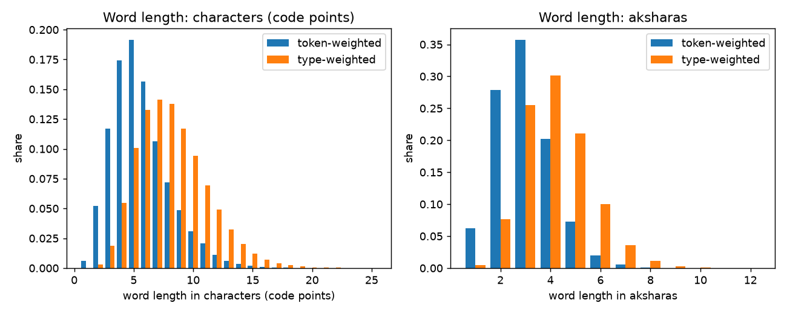

<!-- Generated by scripts/build_report.py from docs/templates/report.md; edit the template. -->
# Phase 1 report: a Konkani (Devanagari) text corpus

**NLP Experiential Learning, Phase 1.** Language: Konkani (ISO 639-3 `gom`/`kok`), Devanagari script.

> **Run of 22 Nov 2026.** Every number comes from `scripts/run_phase1.sh` and is filled in by `scripts/build_report.py`. This run includes 573 Bhaangarbhuin issues (2025-04-02 to 2026-11-20). The pipeline is deterministic: re-running it reproduces every number.

## Summary

| | |
|---|---|
| Clean corpus | **10,505,770 tokens**, 541,967 types, 1,110,440 sentences, 612 documents, 5 domains |
| Format | Plain UTF-8, LF line endings, Unicode NFC; `file` reports "UTF-8 text" |
| Non-Devanagari tokens | 0.00% (numbers 3.50%, as `<NUM>`) |
| OCR quality (book OCR vs. LDC-IL gold) | CER 4.77%, WER 17.86% |
| OCR quality (newspaper, 902 words, AI-transcribed reference) | Corpus text CER 1.06%, WER 4.43% per line; one 2025 page mixes lines across columns |
| Sentence segmentation | Held-out F1 **0.990** (154 paragraphs, 310 boundaries); P 0.984, R 0.997 |
| Non-Konkani text | 1.0% on a 200-paragraph random audit (target < 2%) |
| Splits | Document-level 80.5 / 9.6 / 9.9% of tokens (train/dev/test), plus a domain-balanced subset |

## 1. Sources (brief step 3)

Full bibliographic details are in `metadata/sources.csv`, and per-issue newspaper metadata is in `metadata/epaper_issues.csv`.

| Category | Sources | How text was obtained |
|---|---|---|
| 01 Literature | 9 books (novels, short stories, poetry, drama, children's) + 4 LDC-IL gold-standard files | Book text OCR'd by the team; LDC-IL XML parsed (`extract_ldcil.py`) |
| 02 News | *Bhaangarbhuin*, Goa's Konkani daily: 573 issues, 2025-04-02 to 2026-11-20 | Free e-paper issues downloaded and OCR'd with Tesseract `mar+hin` (`fetch_epaper.py`) |
| 03 Education | NCERT Konkani vocational-education textbook | PDF text layer is broken (doubled vowel signs); re-OCR'd at 300 dpi with `--force-ocr` |
| 04 Culture/history | 6 books (story anthology, Mahabharata in Old Konkani, biography, orthography rules, culture) | OCR text |
| 06 Web | Konkani Wikipedia (`gomwiki`, 1 Nov 2026 dump, CC BY-SA): 2,779 articles | `mwparserfromhell`, Devanagari articles only (≥ 70% Devanagari letters; Romi articles skipped) |

Empty categories: 05 (public information), 07 (oral transcripts). For public information we tried the Goa government press releases: the Department of Information and Publicity site was down, `goa.gov.in` refuses automated access, and its releases are in English.

## 2. Extraction and OCR quality

- **Encoding.** Every file is converted to UTF-8 with LF line endings and the BOM removed. Raw files are never changed; all output goes to `data/interim` and `data/processed`. `.gitattributes` keeps LF line endings on Windows checkouts.
- **OCR quality.** We aligned the hand-typed LDC-IL file `KO00002` with our OCR of the same book (`ocr_quality_check.py`):
  - CER 6.87% and WER 43.33% on the raw OCR;
  - CER **4.77%** and WER **17.86%** once the spurious space before punctuation is removed (a fix that cleaning applies).
- **Most frequent OCR errors** (`results/ocr_quality/confusions.csv`): dropped anusvara `ं`, dropped virama `्`, dropped `ा`.
- **Newspaper OCR quality** (`ocr_quality_check.py --epaper`; details in `results/ocr_quality/epaper_summary.txt`). Six article regions from three issues (Apr 2025, Nov 2025, Jun 2026; 902 words) were transcribed from 300-dpi page images by Claude (AI), not hand-typed, so they are a reference for estimates only.
  - Text stored in the corpus, aligned line by line: CER **1.06%**, WER **4.43%**.
  - Tesseract on each crop as a whole: CER 14.12%, WER 22.17%; 2.75% / 8.36% without one region where Tesseract cut a narrow column into pieces. That error is reading order, not misread letters.
  - On the April 2025 page the full-page OCR interleaves lines from neighbouring columns (only 30–39% of line order kept, against 95–97% on later pages), which breaks some sentences.
- **Inference:** OCR errors are mostly *deletions of small marks*. They create false word types (`आसा`/`आसां`) rather than garbage, which matters for the type counts below.

## 3. Cleaning iterations (brief steps 6–7)

The full rationale and the before/after tables are in [`docs/data_cleaning_log.md`](data_cleaning_log.md). In brief:

| Iteration | Script | What it removes | Tokens after |
|---|---|---|---|
| 0 raw | `extract_text.py` | (nothing) | 11,623,438 |
| 1 cleaned | `clean_text.py` | Page numbers, running headers, boilerplate, Latin/other-script text, OCR spacing; rebuilds paragraphs across line and page breaks | 11,323,158 |
| 2 Konkani only | `validate_konkani.py` | Marathi/Hindi paragraphs (marker-word language ID), Marathi documents, OCR garbage, number tables | 10,940,713 |
| 3 deduplicated | `deduplicate.py` | 51,214 duplicate paragraphs (10.5%): Wikipedia census templates, newspaper boilerplate | **10,505,770** |

**Observations that drove the cleaning:**
- Iteration 0's frequency list was topped by Wikipedia census-template words (`गांवांत` (rank 39), `उपलब्ध` (rank 38), `सगळ्यांत` (rank 48), `लागीं` (rank 47), `अंतराचेर` (rank 72), `किलोमिटर` (rank 218)). These come from bot-generated village stubs: of 73,157 Wikipedia lines only 38,887 were unique.
- `HISTORY.txt` turned out to be Marathi (2 Konkani vs 676 Marathi markers).
- One culture book is a Konkani–Hindi parallel grammar.

A 200-paragraph random audit of the final corpus (`data/eval/language_audit_sample.tsv`) found 2 non-Konkani paragraphs (**1.0%**, target < 2%), 2.0% OCR garbage, 4.0% partly garbled paragraphs and 10.5% newspaper fragments where OCR merged columns.

## 4. Type–token analysis (brief step 4)

Tokens are words with punctuation removed and every number mapped to the single type `<NUM>`. Full output: `results/corpus_statistics.txt`, and every type with its frequency in decreasing order is in `results/word_frequencies.csv`.

|  | Raw (iter 0) | Final |
|---|---|---|
| Tokens N | 11,623,438 | 10,505,770 |
| Types V | 579,049 | 541,967 |
| TTR | 0.050 | 0.052 |
| Hapax legomena | 347,011 (59.9% of types) | 321,329 (59.3% of types, 3.1% of tokens) |
| Zipf slope (ranks 10–10,000) | -1.025 | -1.021 |
| Heaps' law V = K·N^β | K 6.32, β 0.708 | K 6.27, β 0.709 |

| Category | Docs | Tokens | Share | Types | TTR | Hapax % of types |
|---|---|---|---|---|---|---|
| Literature | 13 | 234,999 | 2.2% | 47,285 | 0.201 | 63.3 |
| News | 573 | 9,031,556 | 86.0% | 407,121 | 0.045 | 56.7 |
| Education | 1 | 5,177 | 0.0% | 1,922 | 0.371 | 64.2 |
| Culture/history | 6 | 154,935 | 1.5% | 37,511 | 0.242 | 62.5 |
| Web (Wikipedia) | 20 | 1,079,103 | 10.3% | 166,556 | 0.154 | 64.8 |

The most frequent words are `<NUM>`, `आनी` (and), `ह्या` (this, oblique), `खातीर` (for), `आसा` (is), `हांणी`, `ते` (they/that), `हे` (this/these), `एक` (one), `ना` (not), `अशें` (thus). All are function words, as Zipf's law predicts.

 

## 5. Coverage analysis (brief step 5)

| Token coverage | 10% | 25% | 50% | 75% | 90% | 95% | 99% |
|---|---|---|---|---|---|---|---|
| Types needed (final) | 11 | 129 | 1,087 | 7,636 | 45,020 | 129,135 | 436,910 |
| % of vocabulary | 0.00203 | 0.0238 | 0.201 | 1.41 | 8.31 | 23.8 | 80.6 |
| Types needed (raw) | 5 | 104 | 968 | 7,070 | 43,395 | 129,008 | 462,815 |

Per-category coverage is in `results/coverage_analysis.csv`.

## 6. Sentence segmentation (brief step 8)

`segment_sentences.py` splits on `।`, `॥`, `?` and `!`, and on `.` (Konkani uses the full stop as often as the danda). A verse number `॥ १ ॥` counts as one boundary. A `.` is **not** a boundary in these cases:
- decimals (`37.2`);
- ellipses;
- list numbers at the start of a sentence (`12.`);
- known abbreviations (`डॉ.`, `श्री.`, `इ.स.`, `किमी.`, …);
- initials: a one-akshara word before `.`, or an English letter name (`के.आर.`, `जी. एन. जोशी`, `पी. टी. सर`).

Common one-akshara words that end sentences (`ना`, `हो`, `जा`, `गो`, `यो`, …) are exempt from the initials rule. Closing quotes stay with their sentence. A newspaper dateline (`पणजी:`, `'मडगांव:` …) starts a new sentence even when the headline before it has no full stop. A list number in mid-paragraph (`… ना 13. समासांत`, `कृश्ण 2.त्या`) starts a new sentence *before* the number.

The output is `data/processed/combined/sentences.txt` (one sentence per line) and `sentences.tsv` (doc_id, sent_id, n_tokens, sentence).

**Evaluation** (`data/eval/`, boundaries compared by token position, so the side a quote mark falls on is not an error):

| Gold set | Paragraphs | Gold boundaries | Precision | Recall | F1 |
|---|---|---|---|---|---|
| Development (`segmentation_gold.txt`; rules were tuned on it) | 40 | 100 | 0.990 | 0.980 | 0.985 |
| **Held-out** (`segmentation_gold_heldout.txt`; never used to write rules) | 154 | 310 | 0.984 | 0.997 | **0.990** |

History:
- The first version scored F1 0.934 on the development set.
- The dateline rule and the list-number rule raised it to 0.990.
- With those rules frozen, the held-out set scored **F1 0.989**, above the 0.95 target. This is the honest estimate.
- The held-out set then revealed two gaps, which were fixed: list numbers written with no space (`2.त्या`) and the particles `गो`/`यो`. The table shows the current rules.

Development and held-out paragraphs were sampled separately (seeds 7 and 2027), stratified by category, and half of each set was chosen to contain hard cases (a `.` after a short word, or a colon). Six held-out paragraphs that were pure OCR garbage from advertisement pages were left out.

Remaining errors (`results/segmentation_eval*.txt`) are almost all OCR artefacts:
- a stray `.` inside a word or number (`सूतवाड्. मय`, `37.2. अंश`);
- `आदी.` ("etc.") ending a list in mid-sentence;
- an OCR-split word read as an initial (`मारिना लो.`).

**Limitation:** both gold sets were made by correcting system output, first by an AI assistant. The team should verify them.

## 7. Length analyses (brief step 9)

Full output: `results/length_analysis.txt`, `sentence_length_stats.csv` and `word_length_distribution.csv`.

| Sentence length (tokens) | Sentences | Mean | Median | Std | p95 |
|---|---|---|---|---|---|
| Overall | 1,110,440 | 9.46 | 8 | 7.61 | 23 |
| Literature | 34,018 | 6.91 | 6 | 4.97 | 15 |
| News | 958,324 | 9.42 | 8 | 7.72 | 23 |
| Education | 347 | 14.92 | 13 | 9.38 | 31 |
| Culture/history | 18,685 | 8.29 | 6 | 6.99 | 21 |
| Web (Wikipedia) | 99,066 | 10.89 | 9 | 7.04 | 23 |

| Word length | Token-weighted mean (median) | Type-weighted mean (median) |
|---|---|---|
| Characters (code points) | 5.67 (5) | 8.19 (8) |
| Aksharas | 3.04 (3) | 4.17 (4) |

On average one akshara is 1.87 code points: a consonant plus a vowel sign, conjunct or anusvara.

## 8. Observations and inferences

1. **Konkani vocabulary does not saturate at this size.**
   - **Observation:** The Heaps exponent is β ≈ 0.71. Typical values for English are about 0.4–0.6. 59.3% of types are hapaxes, and covering 90% of tokens takes 45,020 types (8.3% of the vocabulary).
   - **Inference:** This is consistent with the LDC-IL documentation (2018, §9). It says Konkani is "highly agglutinative and morphologically rich … the new words coming into corpus for a unit amount of input is much higher compared to other languages", and that much larger corpora are needed for good coverage. Postpositions fuse with nouns (`घरांत`, `घराक`, `घराचो`), so each noun lemma surfaces as many types. Two consequences follow:
     - for Phase 2, **subword models (BPE/Unigram, FastText)** are needed, because a word-level vocabulary will have a high OOV rate on the test split;
     - for comparison, the LDC-IL corpus has about 4.0M words from 282 titles.
2. **The β value is partly inflated by noise and domain mixing.** Each new domain and each new newspaper issue brings new names, so the growth curve keeps rising. OCR deletions (anusvara, virama) also create false types.
3. **Deduplication matters more than any other cleaning step for frequency statistics.** Removing duplicates took out 4.0% of tokens but moved the 50%-coverage point by 5% (1,032 → 1,087 types), and changed the Zipf slope from -1.03 to -1.02. Without dedup, the frequency list describes a census table, not the language.
4. **Domains differ sharply.**
   - Literature has the shortest sentences (median 6 tokens) and Education the longest (median 13). Fiction is dominated by dialogue and quoted speech; the textbook by expository prose.
   - Among the large categories, News has the lowest TTR (0.045): recurring names, places and formulae.
   - Web (Wikipedia) and Literature have the highest hapax shares.
5. **Function words dominate and are distinctively Konkani.** `आनी`, `आसा`, `ना`, `पूण`, `खातीर` and `जाल्यार` separate Konkani from Marathi (`आणि`, `आहे`, `नाही`, `पण`, `साठी`). That is why the marker-word language ID works: it found a Marathi book and a Hindi parallel text that script-based filtering would have kept.
6. **Spelling variation is large.** Examples: `पूण` 25,847 vs `पुण` 1,236; `म्हूण` 12,980 vs `म्हणून` 9,480; `सगळ्यांत` 3,950 vs `सगल्यांत` 2,967; `हांव` 8,582 vs `हाव` 189. We kept it, since it is real dialect and orthographic variation (Antruzi, Saxtti, Mangalorean and Cochin spellings all occur, e.g. `अश्शि बरंयताति`). It does split the counts for one word, which Phase 2 embeddings should partly recover.
7. **Words average 3.0 aksharas (token-weighted) but 4.2 aksharas (type-weighted).** Frequent words are short function words, while the long tail is long inflected forms. This matches Zipf's law of abbreviation.

## 9. Limitations

- **Domain balance (FR-C6).** News is 86.0% of the corpus, above the 60% cap.
  - The full corpus is kept for Phase 2, because more text gives better language models.
  - `make_splits.py` also writes a domain-balanced subset to `data/splits/balanced/`, with no category above 60%. It has 180 documents and 3,658,414 tokens: literature 6.4%, news 59.7%, education 0.1%, culture/history 4.2%, web (wikipedia) 29.5%.
  - Capped categories keep evenly spaced documents, which for newspapers spreads them over the whole date range.
- **Missing categories.** 05 (public information), 07 (oral transcripts) are empty. Education has one textbook.
- **Residual OCR noise.** Anusvara loss, merged newspaper columns and missing spaces remain. Anusvara is not restored automatically (FR-N9): both forms are often real words (`आसा` "is", `आसां` "I am"), so blind restoring would add errors. CER is measured on book OCR only; newspaper CER needs about 3 hand-typed pages (FR-E6).
- **Language ID uses marker words.** Paragraphs with no markers (short headlines) are kept unchecked.
- **Gold sets annotated by an AI assistant.** The segmentation gold (40 dev + 154 held-out paragraphs) and the language audit (200 paragraphs) were first annotated by an AI assistant and need team verification.
- **Copyright.** Books and the e-paper are copyrighted. The corpus is for non-commercial academic use. The processed text is kept out of the public repository and shared inside the team as a zip.

## 10. Readiness for Phase 2

- `data/splits/{train,dev,test}.txt`: document-level splits (seed 2026; 490/61/61 documents), so no book, issue or Wikipedia shard appears in two splits. The manifest is in `data/splits/split_manifest.csv`, and the totals in `results/split_summary.json`.
- `data/splits/balanced/`: the same split restricted to the domain-balanced subset.
- `data/processed/combined/documents.jsonl` keeps the document boundaries for any re-splitting.
