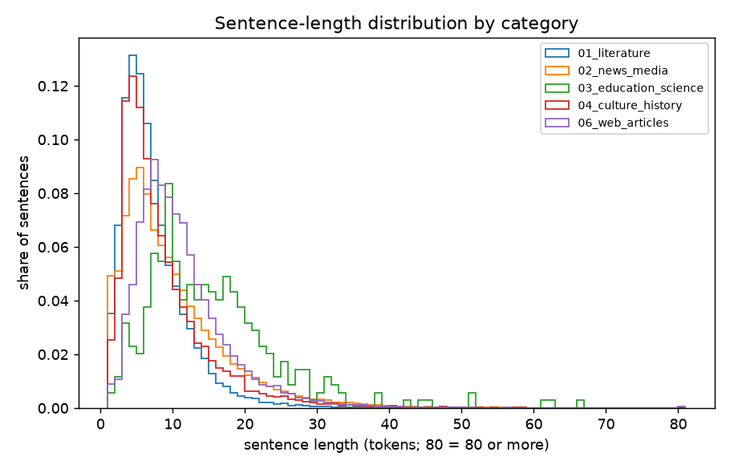

# Phase 1 report: a Konkani (Devanagari) text corpus

**NLP Experiential Learning, Phase 1.** Language: Konkani (ISO 639-3 `gom`/`kok`), Devanagari script.

> **Snapshot: 20 Nov 2026.** All numbers come from `scripts/run_phase1.sh`. The full Bhaangarbhuin e-paper fetch was still running when they were produced: 43 of about 527 issues had been downloaded. The pipeline is deterministic. Re-running it after the fetch finishes updates every number here, with no change to the method.

## Summary

| | |
|---|---|
| Clean corpus | **2,140,209 tokens**, 259,913 types, 221,241 sentences, 82 documents, 5 domains |
| Format | Plain UTF-8, LF line endings, Unicode NFC; `file` reports "UTF-8 text" |
| Non-Devanagari tokens | 0.00% (numbers 2.88%, as `<NUM>`) |
| OCR quality (book OCR vs. LDC-IL gold) | CER 4.77%, WER 17.86% |
| Sentence segmentation | Held-out F1 **0.989** (154 paragraphs, 311 boundaries); P 0.987, R 0.990 |
| Splits | Document-level 80.2 / 11.1 / 8.8% of tokens (train/dev/test) |

## 1. Sources (brief step 3)

Full bibliographic details are in `metadata/sources.csv`, and per-issue newspaper metadata is in `metadata/epaper_issues.csv`.

| Category | Sources | How text was obtained |
|---|---|---|
| 01 Literature | 9 books (novels, short stories, poetry, drama, children's) + 4 LDC-IL gold-standard files | Book text OCR'd by the team; LDC-IL XML parsed (`extract_ldcil.py`) |
| 02 News | *Bhaangarbhuin*, Goa's Konkani daily (Oct 2026 →) | Free e-paper issues downloaded and OCR'd with Tesseract `mar+hin` (`fetch_epaper.py`) |
| 03 Education | NCERT Konkani vocational-education textbook | PDF text layer is broken (doubled vowel signs); re-OCR'd at 300 dpi with `--force-ocr` |
| 04 Culture/history | 6 books (story anthology, Mahabharata in Old Konkani, biography, orthography rules, culture) | OCR text |
| 06 Web | Konkani Wikipedia (`gomwiki`, 1 Nov 2026 dump, CC BY-SA) | `mwparserfromhell`, Devanagari articles only (≥ 70% Devanagari letters; Romi articles skipped) |

Categories 05 (public information) and 07 (oral transcripts) are still empty.

## 2. Extraction and OCR quality

- **Encoding.** Every file is converted to UTF-8 with LF line endings and the BOM removed. Raw files are never changed; all output goes to `data/interim` and `data/processed`. `.gitattributes` keeps LF line endings on Windows checkouts.
- **OCR quality.** We aligned the hand-typed LDC-IL file `KO00002` with our OCR of the same book (`ocr_quality_check.py`):
  - CER 6.87% and WER 43.3% on the raw OCR;
  - CER **4.77%** and WER **17.86%** once the spurious space before punctuation is removed (a fix that cleaning applies).
- **Most frequent OCR errors** (`results/ocr_quality/confusions.csv`): dropped anusvara `ं` (118), dropped virama `्` (30), dropped `ा` (25).
- **Inference:** OCR errors are mostly *deletions of small marks*. They create false word types (`आसा`/`आसां`) rather than garbage, which matters for the type counts below.

## 3. Cleaning iterations (brief steps 6–7)

The full rationale and the before/after tables are in [`docs/data_cleaning_log.md`](data_cleaning_log.md). In brief:

| Iteration | Script | What it removes | Tokens after |
|---|---|---|---|
| 0 raw | `extract_text.py` | (nothing) | 2,615,851 |
| 1 cleaned | `clean_text.py` | Page numbers, running headers, boilerplate, Latin/other-script text, OCR spacing; rebuilds paragraphs across line and page breaks | 2,530,271 |
| 2 Konkani only | `validate_konkani.py` | Marathi/Hindi paragraphs (marker-word language ID), one Marathi book, OCR garbage, number tables | 2,444,245 |
| 3 deduplicated | `deduplicate.py` | 32,420 duplicate paragraphs (31.3%): Wikipedia census templates, newspaper boilerplate | **2,140,209** |

**Observations that drove the cleaning:**
- Iteration 0's frequency list had `गांवांत`, `उपलब्ध` and `अंतराचेर` in the top 11. These come from bot-generated village stubs on Wikipedia: half of all Wikipedia lines were exact repeats.
- `HISTORY.txt` turned out to be Marathi (2 Konkani vs 676 Marathi markers).
- One culture book is a Konkani–Hindi parallel grammar.

A 200-paragraph random audit of the final corpus (`data/eval/language_audit_sample.tsv`) found 2 non-Konkani paragraphs (**1.0%**, target < 2%), 2% OCR garbage, 3.5% partly garbled paragraphs and 10.5% newspaper fragments where OCR merged columns.

## 4. Type–token analysis (brief step 4)

Tokens are words with punctuation removed and every number mapped to the single type `<NUM>`. Full output: `results/corpus_statistics.txt`, and every type with its frequency in decreasing order is in `results/word_frequencies.csv`.

| | Raw (iter 0) | Final |
|---|---|---|
| Tokens N | 2,615,851 | 2,140,209 |
| Types V | 282,711 | 259,913 |
| TTR | 0.108 | 0.121 |
| Hapax legomena | 176,864 (62.6% of types) | 162,435 (62.5% of types, 7.6% of tokens) |
| Zipf slope (ranks 10–10,000) | −1.023 | −0.988 |
| Heaps' law V = K·N^β | K 3.88, β 0.759 | K 3.76, β 0.762 |

| Category | Docs | Tokens | Share | Types | TTR | Hapax % of types |
|---|---|---|---|---|---|---|
| Literature | 13 | 234,999 | 11.0% | 47,285 | 0.201 | 63.3 |
| News | 43 | 665,943 | 31.1% | 79,163 | 0.119 | 56.9 |
| Education | 1 | 5,177 | 0.2% | 1,922 | 0.371 | 64.2 |
| Culture/history | 6 | 154,942 | 7.2% | 37,511 | 0.242 | 62.5 |
| Web (Wikipedia) | 20 | 1,079,148 | 50.4% | 166,558 | 0.154 | 64.8 |

The most frequent words are `<NUM>`, `आनी` (and), `ह्या` (this, oblique), `आसा` (is), `एक` (one), `हे`, `ते`, `तो`, `ना` (not), `ताका` (to him) and `पूण` (but). All are function words, as Zipf's law predicts.

 

## 5. Coverage analysis (brief step 5)

| Token coverage | 10% | 25% | 50% | 75% | 90% | 95% | 99% |
|---|---|---|---|---|---|---|---|
| Types needed (final) | 12 | 136 | 1,393 | 12,365 | 71,686 | 152,903 | 238,511 |
| % of vocabulary | 0.005 | 0.05 | 0.54 | 4.8 | 27.6 | 58.8 | 91.8 |
| Types needed (raw) | 6 | 85 | 1,006 | 9,768 | 64,926 | 151,919 | 256,553 |

Per-category coverage is in `results/coverage_analysis.csv`.

## 6. Sentence segmentation (brief step 8)

`segment_sentences.py` splits on `।`, `॥`, `?` and `!`, and on `.` (Konkani uses the full stop as often as the danda). A verse number `॥ १ ॥` counts as one boundary. A `.` is **not** a boundary in these cases:
- decimals (`37.2`);
- ellipses;
- list numbers (`12.`);
- known abbreviations (`डॉ.`, `श्री.`, `इ.स.`, `किमी.`, …);
- initials: a one-akshara word before `.`, or an English letter name (`के.आर.`, `जी. एन. जोशी`, `पी. टी. सर`).

Common one-akshara words that end sentences (`ना`, `हो`, `जा`, …) are exempt from the initials rule. Closing quotes stay with their sentence.

The output is `data/processed/combined/sentences.txt` (one sentence per line) and `sentences.tsv` (doc_id, sent_id, n_tokens, sentence).

A newspaper dateline (`पणजी:`, `'मडगांव:` …) starts a new sentence even when the headline before it has no full stop. A list number (`… ना 13. समासांत`, `कृश्ण 2.त्या`) starts a new sentence *before* the number.

**Evaluation** (`data/eval/`, boundaries compared by token position, so the side a quote mark falls on is not an error):

| Gold set | Paragraphs | Gold boundaries | Precision | Recall | F1 |
|---|---|---|---|---|---|
| Development (`segmentation_gold.txt`; rules were tuned on it) | 40 | 99 | 0.934 → 0.990 | 0.929 → 0.990 | 0.934 → **0.990** |
| **Held-out** (`segmentation_gold_heldout.txt`; never used for development), rules frozen | 154 | 311 | 0.987 | 0.990 | **0.989** |
| Held-out after two fixes it revealed | 154 | 311 | 0.987 | 0.997 | 0.992 |

The honest estimate is the frozen held-out score, **F1 0.989**, above the 0.95 target. Development and held-out paragraphs were sampled separately (seeds 7 and 2027), stratified by category, and half of each set was chosen to contain hard cases (a `.` after a short word, or a colon). Six held-out paragraphs that were pure OCR garbage from advertisement pages were left out.

The rules added after the first dev-set evaluation were the newspaper dateline rule and splitting before list numbers. The held-out set then revealed two further gaps: list numbers written with no space (`2.त्या`) and the sentence-final particles `गो`/`यो`.

Remaining errors (`results/segmentation_eval*.txt`) are almost all OCR artefacts:
- a stray `.` inside a word or number (`सूतवाड्. मय`, `37.2. अंश`);
- `आदी.` ("etc.") ending a list in mid-sentence;
- an OCR-split word read as an initial (`मारिना लो.`).

**Limitation:** both gold sets were made by correcting system output, first by an AI assistant. The team should verify them.

## 7. Length analyses (brief step 9)

Full output: `results/length_analysis.txt`, `sentence_length_stats.csv` and `word_length_distribution.csv`.

| Sentence length (tokens) | Sentences | Mean | Median | Std | p95 |
|---|---|---|---|---|---|
| Overall | 221,241 | 9.67 | 8 | 7.13 | 23 |
| Literature | 33,927 | 6.93 | 6 | 4.98 | 16 |
| News | 69,246 | 9.62 | 8 | 7.69 | 24 |
| Education | 347 | 14.92 | 13 | 9.38 | 31 |
| Culture/history | 18,666 | 8.30 | 6 | 6.99 | 21 |
| Web | 99,055 | 10.89 | 9 | 7.04 | 23 |

| Word length | Token-weighted mean (median) | Type-weighted mean (median) |
|---|---|---|
| Characters (code points) | 5.63 (5) | 7.94 (8) |
| Aksharas | 3.00 (3) | 4.05 (4) |

On average one akshara is 1.88 code points: a consonant plus a vowel sign, conjunct or anusvara.

## 8. Observations and inferences

1. **Konkani vocabulary does not saturate at this size.**
   - **Observation:** The Heaps exponent is β ≈ 0.76. Typical values for English are about 0.4–0.6. 62% of types are hapaxes, and covering 90% of tokens takes 71,686 types (27.6% of the vocabulary).
   - **Inference:** This is consistent with the LDC-IL documentation (2018, §9). It says Konkani is "highly agglutinative and morphologically rich … the new words coming into corpus for a unit amount of input is much higher compared to other languages", and that much larger corpora are needed for good coverage. Postpositions fuse with nouns (`घरांत`, `घराक`, `घराचो`), so each noun lemma surfaces as many types. Two consequences follow:
     - for Phase 2, **subword models (BPE/Unigram, FastText)** are needed, because a word-level vocabulary will have a high OOV rate on the test split;
     - the LDC-IL corpus (about 4.0M words from 282 titles) is only about twice our size, so its type counts should be of the same order.
2. **The β value is partly inflated by noise and domain mixing.** Document order puts Wikipedia last, so the growth curve keeps rising as new topics bring new names. OCR deletions (anusvara, virama) also create false types. Normalising anusvara (FR-N9) would lower V without changing N.
3. **Deduplication matters more than any other cleaning step for frequency statistics.** Template text removed 12% of tokens but moved the 50%-coverage point by 45% (959 → 1,393 types) and pulled the Zipf slope from −1.03 to −0.99. Without dedup, the frequency list describes a census table, not the language.
4. **Domains differ sharply.**
   - Literature has the shortest sentences (median 6 tokens): dialogue and quoted speech.
   - The textbook has the longest (median 13): expository prose.
   - News has the lowest TTR among large categories (0.119): recurring names, places and formulae.
   - Literature and culture/history have the highest hapax shares: rich vocabulary, archaic Old-Konkani Mahabharata spellings, and verse.
5. **Function words dominate and are distinctively Konkani.** `आनी`, `आसा`, `ना`, `पूण`, `खातीर` and `जाल्यार` separate Konkani from Marathi (`आणि`, `आहे`, `नाही`, `पण`, `साठी`). That is why the marker-word language ID works: it found one Marathi book and one Hindi parallel text that script-based filtering would have kept.
6. **Spelling variation is large.** Examples: `पूण`/`पुण`, `म्हूण`/`म्हणून`, `सगळ्यांत`/`सगल्यांत`. We kept it, since it is real dialect and orthographic variation (Antruzi, Saxtti, Mangalorean and Cochin spellings all occur, e.g. `अश्शि बरंयताति`). It does split the counts for one word, which Phase 2 embeddings should partly recover.
7. **Words average 3 aksharas (token-weighted) but 4 aksharas (type-weighted).** Frequent words are short function words, while the long tail is long inflected forms. This matches Zipf's law of abbreviation.

## 9. Limitations

- **Domain balance.** In this snapshot Wikipedia is 50% of the corpus. After the full e-paper fetch, news will be above 60%, breaking FR-C6 (P2). We will either cap news issues or sample by domain for the splits.
- **Missing categories.** Public information (05) and oral transcripts (07) are empty. Education has one textbook.
- **Residual OCR noise.** Anusvara loss, merged newspaper columns and missing spaces remain. CER is measured on book OCR only; newspaper CER has not yet been measured (FR-E6 needs about 3 hand-typed pages).
- **Language ID uses marker words.** Paragraphs with no markers (short headlines) are kept unchecked.
- **Gold sets annotated by an AI assistant.** The segmentation gold (40 dev + 154 held-out paragraphs) and the language audit (200 paragraphs) were first annotated by an AI assistant and need team verification.
- **Copyright.** Books and the e-paper are copyrighted. The corpus is for non-commercial academic use. The processed text is kept out of the public repository and shared inside the team as a zip.

## 10. Readiness for Phase 2

- `data/splits/{train,dev,test}.txt`: document-level splits (seed 2026; 66/8/8 documents), so no book, issue or Wikipedia shard appears in two splits. The manifest is in `data/splits/split_manifest.csv`.
- `data/processed/combined/documents.jsonl` keeps the document boundaries for any re-splitting.
- Before tagging `corpus-v1.0`: finish the e-paper fetch, re-run `scripts/run_phase1.sh`, refresh the numbers in this report and the cleaning log, and zip `data/processed` + `data/splits` for the team.
- Note: the files in `results/` are rewritten on every pipeline run, so between now and the final run they can be from a later snapshot (more newspaper issues) than the numbers quoted here.
